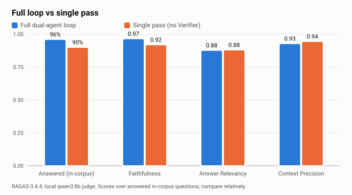
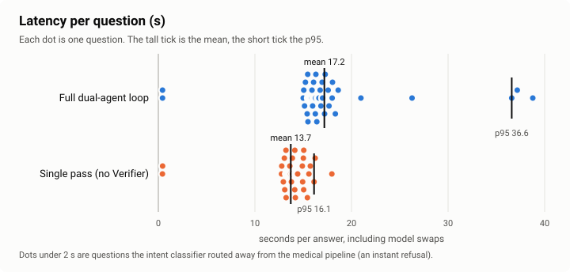

# VeriDoc AI — evaluation metrics

Generated by `ai_service/eval/report.py` from:
- Ablation summary: `summary-20261122-0845.csv`
- Per-question results: `results-20261122-0845.csv`
- Performance run: `runs-20261122-1111.jsonl`

## Ablation: full dual-agent loop vs single pass

Scores are RAGAS 0.4.4 with the local `qwen3:8b` as judge, over answered in-corpus questions. Compare the columns relatively: an 8B judge is weaker than GPT-4-class judges, and a few points on ~50 questions is not significant.

| | Full dual-agent loop | Single pass (no Verifier) |
|---|---|---|
| Questions (in-corpus / off-corpus) | 50 / 5 | 50 / 5 |
| In-corpus questions answered | 96% | 90% |
| Fell back on an in-corpus question | 0% | 6% |
| Off-corpus questions refused | 100% | 100% |
| Faithfulness | 0.97 | 0.92 |
| Faithfulness, paired subset | 0.96 | 0.92 |
| Answer Relevancy | 0.88 | 0.88 |
| Context Precision | 0.93 | 0.94 |
| Average iterations | 1.30 | 1.00 |
| Latency mean / median / p95 (s) | 17.2 / 16.3 / 36.6 | 13.7 / 13.9 / 16.1 |
| Cites the expected source | 88% | 89% |

## Performance (Phase 8.4)

Measured on 55 questions (full loop).

| Latency (s) | n | Mean | Median | p95 |
|---|---|---|---|---|
| Whole turn | 55 | 17.6 | 16.0 | 38.6 |
| Iteration 1 | 53 | 15.6 | 15.5 | 18.6 |
| Iteration 2 | 11 | 9.2 | 4.9 | 23.3 |
| Iteration 3 | 6 | 1.6 | 1.0 | 4.5 |
| Turns that used all 3 iterations | 6 | 20.8 | 15.9 | 47.0 |

| Prompt tokens (Ollama's count) | Calls | Mean | p95 | Max | Under 7,000? |
|---|---|---|---|---|---|
| classify | 54 | 424 | 434 | 436 | yes |
| generate | 70 | 1,817 | 4,573 | 5,090 | yes |
| verify | 53 | 1,661 | 3,538 | 4,638 | yes |
